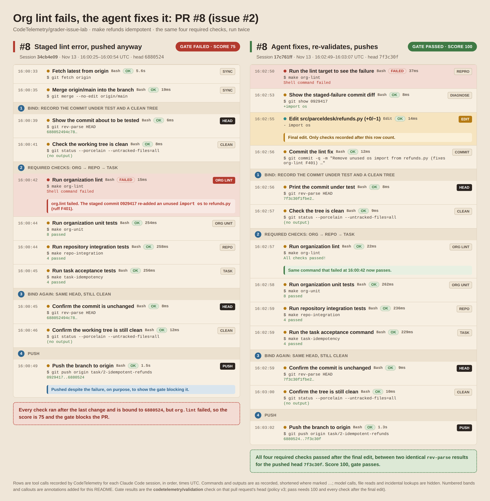
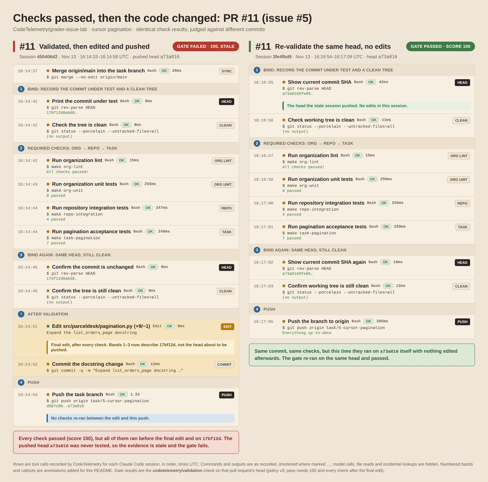

# Grader issue lab

A small, reproducible example of the Code Telemetry PR Grader applying
**organization → repository → task (GitHub issue)** validation policy to six real
GitHub issues and pull requests.

> **Status, 2026-11-13.** Live. Organization, repository and task checks are
> published together as this workspace's Grader policy (version 3), and every PR
> below is judged by the real `codetelemetry/validation` gate from recorded
> Claude Code sessions. Failures marked *staged* were introduced on purpose to
> show the gate blocking them; the sessions that ran against them, and the fixes,
> are real. The offline simulator (`make offline-repro`) still covers cases that
> are hard to stage live, such as truncated output and PR-body injection.

## The three-step trick

1. **Define the required checks** as exact commands at each level: the org
   baseline (`make org-lint`, `make org-unit`), the repository contract
   (`make repo-integration`), and each issue's acceptance command (`make task-…`).
2. **Capture what actually ran.** The agent's session is recorded, so you can see
   which commands ran, their outcome, and whether they ran *after the final edit*.
3. **Verify on the PR.** The `codetelemetry/validation` check passes only if every
   effective check passed after the final edit for that exact head SHA. Stale,
   failed, missing and unknown evidence are reported as such, never as green.

## What the gate sees

Each picture puts two recorded sessions on the same pull request side by side.
The rows are the tool calls CodeTelemetry captured, in order. The numbered bands
and callouts are annotations that show how the gate reads them: bind the commit and
a clean tree (1), run every required check (2), confirm the same commit and a
clean tree (3), then push (4).

**A check fails, then the fix is re-validated** ([#8](https://github.com/CodeTelemetry/grader-issue-lab/pull/8), issue [#2](https://github.com/CodeTelemetry/grader-issue-lab/issues/2)).
Both sessions run all four checks between matching `git rev-parse HEAD` lines. The
first one fails `org.lint` and scores 75. The second removes the unused import,
re-runs everything on the new head, and scores 100.



**Every check passes, but the evidence is stale** ([#11](https://github.com/CodeTelemetry/grader-issue-lab/pull/11), issue [#5](https://github.com/CodeTelemetry/grader-issue-lab/issues/5)).
The left session passes all four checks on `17bf12d`, then edits and pushes
`a73a016` without re-running them, so the score is 100 and the gate still fails. The
right session re-runs the same checks on `a73a016` without editing anything and
passes.



Commands and outputs are as recorded, shortened where marked with `…`. Model calls,
file reads and incidental lookups are hidden. The full sessions are listed under
[Traceability](#traceability).

## Run it (offline, about a minute)

```sh
git clone https://github.com/CodeTelemetry/grader-issue-lab.git && cd grader-issue-lab
make install
make org-lint org-unit repo-integration
make labgrader-test offline-repro     # expect: 18 fixtures, 0 mismatches
```

Python 3.12+. Only pytest and ruff, both pinned. No cloud service. See
[docs/REPRODUCE.md](docs/REPRODUCE.md) for the optional live path.

## How policy combines

`effective = org ∪ repo ∪ task(issue₁) ∪ task(issue₂) …`. Levels only add. Task
checks come from a reviewed, versioned mapping, selected by the issues GitHub says
the PR closes. PR and issue text is never policy. Missing or untrusted linkage
makes the task level **unknown** (fail closed). Details and current product gaps
are in [docs/POLICY-HIERARCHY.md](docs/POLICY-HIERARCHY.md).

## The six assignments

| # | Assignment | Task check | Demonstrated outcome | Simulator fixtures |
| -- | -- | -- | -- | -- |
| 1 | Fix currency rounding | `make task-rounding` | all org/repo/task checks pass | `01-rounding-pass` |
| 2 | Make refunds idempotent | `make task-idempotency` | org lint fails; repo and task pass | `02-…fail`, `02r-…remediated` |
| 3 | Make CSV import atomic | `make task-csv-atomic` | repo integration fails; org and task pass | `03-…fail`, `03r-…remediated` |
| 4 | Restrict customer order access | `make task-authorization` | task acceptance fails; org and repo pass | `04-…fail`, `04r-…remediated` |
| 5 | Implement cursor pagination | `make task-pagination` | tests ran, then source edited and pushed: stale | `05-…stale`, `05r-…remediated` |
| 6 | Redact secrets in audit logs | `make task-redaction` | truncated output or telemetry gap: unknown | `06-…truncated`, `06-…gap`, `06r-…remediated` |

More fixtures: multiple issues in one PR (union), an unlinked PR, a PR-body
injection attempt, an unmapped issue, and a second repository (`ledger-lite`) that
reuses the organization baseline without ParcelDesk's repository checks.

## Traceability

<!-- traceability:start -->
Every row is a real Claude Code session (2.1.322), launched from this checkout with
`--settings .claude/settings.local.json` unless noted. The gate result is the
`codetelemetry/validation` decision for that exact head commit under policy v3.
Session IDs are the first 8 characters of the sessions recorded in this lab's
Code Telemetry workspace.

| Issue | PR | Step | Head | Session | Gate | Why |
| -- | -- | -- | -- | -- | -- | -- |
| [#1](https://github.com/CodeTelemetry/grader-issue-lab/issues/1) | [#7](https://github.com/CodeTelemetry/grader-issue-lab/pull/7) | validate and push | `375f5da` | `f3e1f11a` | ✅ [100](https://github.com/CodeTelemetry/grader-issue-lab/actions/runs/43431340765) | org, repo and `task.rounding` passed after the final change, bound to the head |
| [#2](https://github.com/CodeTelemetry/grader-issue-lab/issues/2) | [#8](https://github.com/CodeTelemetry/grader-issue-lab/pull/8) | staged unused import, validate, push anyway | `6880524` | `34cb4e09` | ❌ [75](https://github.com/CodeTelemetry/grader-issue-lab/actions/runs/43458359693) | `org.lint` failed (ruff F401) |
| | | agent fixes, re-validates, pushes | `7f3c30f` | `17c761ff` | ✅ [100](https://github.com/CodeTelemetry/grader-issue-lab/actions/runs/43458747563) | import removed; all checks passed |
| [#3](https://github.com/CodeTelemetry/grader-issue-lab/issues/3) | [#9](https://github.com/CodeTelemetry/grader-issue-lab/pull/9) | staged error-message regression, validate, push anyway | `895eed5` | `fa377132` | ❌ [75](https://github.com/CodeTelemetry/grader-issue-lab/actions/runs/43459139644) | `parceldesk.integration` failed |
| | | agent fixes, re-validates, pushes | `a6bcb8e` | `8086d73b` | ✅ [100](https://github.com/CodeTelemetry/grader-issue-lab/actions/runs/43459603862) | integration contract restored |
| [#4](https://github.com/CodeTelemetry/grader-issue-lab/issues/4) | [#10](https://github.com/CodeTelemetry/grader-issue-lab/pull/10) | staged missing-order leak, validate, push anyway | `0254d8f` | `57d20391` | ❌ [75](https://github.com/CodeTelemetry/grader-issue-lab/actions/runs/43460002571) | `task.authorization` failed |
| | | agent fixes, re-validates, pushes | `57df0de` | `32e9e5ad` | ✅ [100](https://github.com/CodeTelemetry/grader-issue-lab/actions/runs/43460392701) | missing order now denied like a foreign one |
| [#5](https://github.com/CodeTelemetry/grader-issue-lab/issues/5) | [#11](https://github.com/CodeTelemetry/grader-issue-lab/pull/11) | validate, then edit and push without re-running | `a73a016` | `450406d2` | ❌ [100, stale](https://github.com/CodeTelemetry/grader-issue-lab/actions/runs/43460790921/attempts/2) | every check passed, but before the final edit |
| | | re-validate the same head, no edits | `a73a016` | `3fe4fbd9` | ✅ [100](https://github.com/CodeTelemetry/grader-issue-lab/actions/runs/43460790921/attempts/5) | checks re-ran with the tree bound to the head and nothing edited; the earlier stale session pushed before this one observed the head, so it is released |
| [#6](https://github.com/CodeTelemetry/grader-issue-lab/issues/6) | [#12](https://github.com/CodeTelemetry/grader-issue-lab/pull/12) | validate and push **without** `--settings` (telemetry gap) | `05f1b2c` | not visible to the gate | ❌ [no session](https://github.com/CodeTelemetry/grader-issue-lab/actions/runs/43461562161/attempts/2) | telemetry went to the user-level key; the gate waited, then failed closed |
| | | re-validate the same head with `--settings` | `05f1b2c` | `cf35cf8b` | ✅ [100](https://github.com/CodeTelemetry/grader-issue-lab/actions/runs/43461562161/attempts/4) | evidence now reaches the workspace, bound to the head |

Each gate link is the workflow run for that head; a run's later attempts show the
verdict after the next session. The score is the weighted share of required checks
that passed. The gate needs 100 **and** every required check verified after the
final edit for the exact head commit, so a stale run scores 100 and still fails.

Gate decisions on the six PRs earlier than these rows predate the backend fixes
that made Claude Code sessions bindable (ElliotGardiner/claude-local PRs 1191,
1197, 1206, 1207, 1208) and are superseded.

### Sister PRs that fail the gate

Each passing task PR above has a sister PR that closes the same issue and stays
open with a failing `codetelemetry/validation` check. Each is a real session
(Claude Code 2.1.321, `--settings`) recorded in this lab's workspace; the defect or
the skipped step was staged on purpose and is stated in the session's prompt.
These sessions exported through a local relay that replaces the account email
with `elliot@codetelemetry.com`; nothing else in the telemetry was changed.

| Issue | Sister of | PR | Step | Head | Session | Gate | Why |
| -- | -- | -- | -- | -- | -- | -- | -- |
| [#1](https://github.com/CodeTelemetry/grader-issue-lab/issues/1) | [#7](https://github.com/CodeTelemetry/grader-issue-lab/pull/7) | [#24](https://github.com/CodeTelemetry/grader-issue-lab/pull/24) | validate org and repo checks, skip the task check, push | `a1a051d` | `7a284a52` | ❌ [75](https://github.com/CodeTelemetry/grader-issue-lab/actions/runs/45868940978) | `task.rounding` never ran (not observed) |
| [#2](https://github.com/CodeTelemetry/grader-issue-lab/issues/2) | [#8](https://github.com/CodeTelemetry/grader-issue-lab/pull/8) | [#25](https://github.com/CodeTelemetry/grader-issue-lab/pull/25) | staged unused import, validate, push anyway | `0725b11` | `2973458e` | ❌ [75](https://github.com/CodeTelemetry/grader-issue-lab/actions/runs/45869182456) | `org.lint` failed (ruff F401) |
| [#3](https://github.com/CodeTelemetry/grader-issue-lab/issues/3) | [#9](https://github.com/CodeTelemetry/grader-issue-lab/pull/9) | [#26](https://github.com/CodeTelemetry/grader-issue-lab/pull/26) | staged error-message regression, validate, push anyway | `9f6bf90` | `dbff5005` | ❌ [75](https://github.com/CodeTelemetry/grader-issue-lab/actions/runs/45869186529) | `parceldesk.integration` failed |
| [#4](https://github.com/CodeTelemetry/grader-issue-lab/issues/4) | [#10](https://github.com/CodeTelemetry/grader-issue-lab/pull/10) | [#27](https://github.com/CodeTelemetry/grader-issue-lab/pull/27) | staged missing-order leak, validate, push anyway | `ca11f3e` | `af50b6f5` | ❌ [75](https://github.com/CodeTelemetry/grader-issue-lab/actions/runs/45869192135) | `task.authorization` failed |
| [#5](https://github.com/CodeTelemetry/grader-issue-lab/issues/5) | [#11](https://github.com/CodeTelemetry/grader-issue-lab/pull/11) | [#28](https://github.com/CodeTelemetry/grader-issue-lab/pull/28) | validate, then edit, commit and push without re-running | `86360f0` | `1443359c` | ❌ [100, stale](https://github.com/CodeTelemetry/grader-issue-lab/actions/runs/45869395051) | every check passed, but before the final edit |
| [#6](https://github.com/CodeTelemetry/grader-issue-lab/issues/6) | [#12](https://github.com/CodeTelemetry/grader-issue-lab/pull/12) | [#29](https://github.com/CodeTelemetry/grader-issue-lab/pull/29) | validate with an untracked file in the tree, push | `c60b97b` | `139be75d` | ❌ [100](https://github.com/CodeTelemetry/grader-issue-lab/actions/runs/45869403436) | every check passed, but `git status` was not clean, so the tested tree is not the pushed commit; the replay finds no verified pushed change |

### Not live yet

| Gap | Where it stands |
| -- | -- |
| A second repository reusing the org baseline | offline fixture `ledger-lite` only |
| Truncated-output *unknown* and PR-body injection | offline fixtures only |
| Gate on new PRs after GitHub starts blocking `pull_request_target` in public repositories (2026-12-02, brownout 2026-11-16) | an active event policy allows the event for the gate workflow only (docs/REPRODUCE.md (b)3); it is in place but not yet exercised by a block |
<!-- traceability:end -->

## Layout

```text
src/parceldesk/            app: money, refunds, csv_import, access, pagination, audit
src/labgrader/             offline org → repo → task simulator (synthetic only)
tests/unit|integration     org baseline and repository contract
tests/acceptance/          one file per task, added by that task's PR
tests/labgrader/           simulator semantics
.codetelemetry/            org + repo Grader checks (real format), gate, demo task mapping
examples/evidence/         synthetic session fixtures
examples/scenarios/        expected-results matrix
```

MIT licensed.
